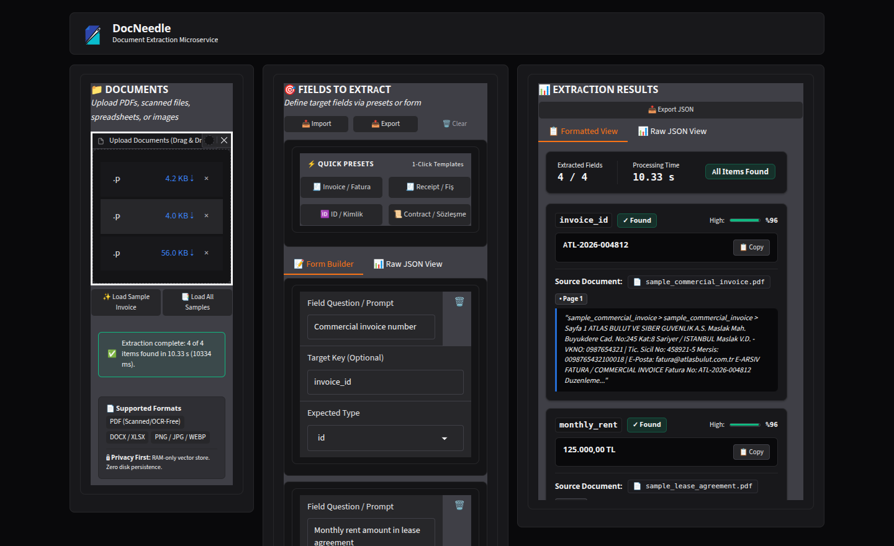

# DocNeedle: Schema-Guided Local Document Information Extraction Engine

Extracting structured data from enterprise documents—invoices, regulatory filings, multipage contracts, and handwritten receipts—remains a major operational bottleneck. Traditional optical character recognition (OCR) engines produce cascading character errors on degraded scans or nested tables; commercial cloud APIs expose confidential corporate intelligence to external servers; and large foundation models suffer severe attention degradation and hallucinate when documents exceed 50 pages.

**DocNeedle** is an open-source, **100% local and privacy-first structured information extraction engine and microservice platform** built to solve these structural challenges.

It ingests unstructured documents alongside a user-defined JSON schema, producing strictly validated JSON data where every single field is accompanied by an auditable page reference, direct text citation, and statistical confidence score. Enterprise payloads never touch persistent storage, and zero bytes are transmitted to external cloud APIs.



---

## System Architecture & End-to-End Pipeline

DocNeedle unifies document ingestion, cross-modal embedding, hybrid retrieval, and in-process model inference within an ephemeral memory lifecycle:

```
[Uploaded Document & JSON Schema]
               │
               ▼
┌────────────────────────────────────────────────────────┐
│ Volatile In-Memory Pipeline (PR_SET_DUMPABLE = 0)      │
│                                                        │
│  Docling Parser (io.BytesIO) ──► AcroForm Inspection   │
│         │                                              │
│         ▼                                              │
│  SessionVectorStore (In-Memory RRF Hybrid Index)       │
│         │                                              │
│         ▼                                              │
│  In-Process Multimodal LLM (Qwen3.5-4B + mmproj)       │
│         │                                              │
│         ▼                                              │
│  Spatial Collision Resolver & Confidence Verifier      │
└────────────────────────────────────────────────────────┘
               │
               ▼
[Audited JSON Output with Page Citations]
               │
               ▼
    finally: store.clear() (RAM purged immediately)
```

The modular codebase enforces a strict separation of concerns from kernel-level security hardening down to the native C++ inference layer:

```
DocNeedle/
├── .github/
│   └── workflows/
│       └── ci.yml                # CI: lint, 159 unit tests, container enforcement, smoke
├── assets/
│   ├── logo.svg / logo.png       # Vector and raster brand logos
│   ├── favicon.svg               # Application favicon
│   ├── demo.gif                  # Live extraction walkthrough animation
│   ├── dashboard_preview.png     # Web dashboard preview screenshot
│   └── examples/                 # Sample documents (invoice, lease contract, receipt)
├── app.py                        # Unified Gradio 6 UI + FastAPI root mount & ZeroGPU entry
├── config.toml                   # Application, model & pipeline configuration
├── pyproject.toml / requirements.txt
├── Dockerfile                    # Multi-stage Python 3.14-slim production & test image
├── docker-compose.yml            # Unified compose with `gpu` and `cpu` hardware profiles
├── scripts/
│   ├── download_models.py        # Quantized GGUF model downloader with verification
│   ├── benchmark_extractbench.py # ExtractBench runner (Value F1, Grounding F1)
│   └── deploy_space.sh           # Hugging Face Spaces (ZeroGPU) deployment script
├── models/
│   ├── embedding/                # EmbeddingGemma-2 GGUF + mmproj-F16 vision projector
│   ├── llm/                      # Qwen3.5-4B-Q4_K_M GGUF + mmproj-Qwen3.5-4B-F16
│   └── reranker/                 # Qwen3-Reranker-0.6B.Q4_K_M GGUF
├── src/docneedle/
│   ├── main.py                   # FastAPI factory, CORS, /healthz
│   ├── config.py                 # Pydantic BaseSettings (TOML + env)
│   ├── hardening.py              # Kernel PR_SET_DUMPABLE hardening (fail-fast)
│   ├── cuda_compat.py            # ZeroGPU preloaders & memory leasing wrappers
│   ├── api/
│   │   ├── routes_extract.py     # POST /v1/extract (synchronous extraction)
│   │   ├── routes_jobs.py        # POST /v1/jobs, GET /v1/jobs/{id}, SSE /events
│   │   └── validation.py         # Recursive $ref dereferencing & payload bounds
│   ├── jobs/
│   │   ├── models.py             # JobStatus, JobProgress, response contracts
│   │   └── manager.py            # In-memory job registry, SSE broadcast queues, TTL
│   ├── ingest/
│   │   ├── parser.py             # In-memory Docling + pypdfium2 parsing (zero-disk)
│   │   ├── chunker.py            # DoclingChunker with heading & visual attachment
│   │   ├── acroform.py           # Interactive PDF AcroForm field extractor
│   │   ├── cache.py              # Thread-safe in-memory LRU document cache
│   │   ├── service.py            # IngestionService coordinator
│   │   └── models.py             # Ingestion chunk & document models
│   ├── retrieval/
│   │   ├── embedder.py           # ctypes binding to native libdocneedle_embed.so
│   │   ├── docneedle_embed.cpp   # Native C++ cross-modal embedding engine
│   │   ├── worker.py             # Process-isolated embedder host (RTLD_DEEPBIND)
│   │   ├── bm25.py               # Okapi BM25 lexical search engine
│   │   ├── reranker.py           # Qwen3-Reranker cross-encoder logit scorer
│   │   ├── store.py              # SessionVectorStore (in-memory RRF & diversity)
│   │   └── models.py             # SearchResult model
│   ├── extraction/
│   │   ├── service.py            # Retrieval query synthesis & LLM orchestration
│   │   ├── verifier.py           # ConfidenceCalculator & type validation
│   │   ├── matcher.py            # Exact/fuzzy chunk text & page evidence resolver
│   │   ├── collision.py          # SpatialCollisionResolver for duplicate values
│   │   └── schemas.py            # Extraction request/response Pydantic models
│   └── llm/
│       ├── local_engine.py       # LocalLLMEngine (Qwen3.5-4B GGUF + mmproj vision)
│       ├── client.py             # LLMClient interface
│       ├── handlers.py           # Multimodal chat completion handlers
│       ├── parsing.py            # Output cleaning, JSON extraction, unicode fix
│       ├── prompts.py            # Schema-constrained prompt builder
│       └── speculative.py        # Prompt Lookup Decoding draft manager
└── tests/
    ├── test_zero_disk.py         # Kernel PR_SET_DUMPABLE & zero-disk parser tests
    ├── test_clean_modules.py     # Unit tests for parsing, verifier, matcher, prompts
    ├── test_collision*.py        # Spatial collision resolution tests (EN & TR)
    ├── test_acroform.py          # Interactive PDF AcroForm extraction tests
    ├── test_ocr_grounding.py     # Multimodal visual grounding & citation tests
    ├── test_ui_schema_sync.py    # Gradio 6 schema builder synchronization tests
    ├── test_health.py            # /healthz & hardware diagnostics tests
    └── test_extraction.py        # End-to-end extraction integration tests
```

---

## Core Engineering Highlights

### 1. Zero-Disk In-Memory Privacy & Kernel Hardening

When processing sensitive financial filings, medical records, or proprietary contracts, relying on software-level temporary files is unacceptable. DocNeedle enforces an air-gapped data guarantee directly at the OS level:

* **Volatile-Only Memory (RAM-Only):** Uploaded files are ingested directly as byte streams (`io.BytesIO`). Chunks, embeddings, and inverted indexes reside strictly within the ephemeral `SessionVectorStore`. Every request unconditionally purges its allocated buffers inside a `finally: store.clear()` block, returning all pages to the operating system.
* **Kernel Anti-Dumping Protection:** The `src/docneedle/hardening.py` module activates the Linux kernel `prctl(PR_SET_DUMPABLE, 0)` flag at startup. This prevents unauthorized core dumping and blocks external debuggers (`ptrace`) from inspecting or dumping process memory.
* **Hardened Container & CI Enforcement:** Production containers enforce a read-only root filesystem (`read_only: true`), temporary directories mapped strictly to system RAM (`tmpfs`, 1 GB, `nosuid`), zero core dump limits, and an offline Hugging Face mode (`HF_HUB_OFFLINE=1`). The GitHub Actions CI workflow automatically validates the `PR_SET_DUMPABLE=0` kernel log, the health endpoint under read-only rootfs, and fail-fast handling (HTTP 415) for unsupported formats.

### 2. OCR-Free Visual RAG & Native C++ Vector Core

Traditional pipelines funnel raw documents through an OCR engine first. When characters degrade or table layouts collapse, corrupted text is passed to the LLM, making reliable extraction impossible. DocNeedle takes a dual-track ingestion approach:

* **Digital Documents:** Files containing native text layers are parsed using Docling Core into clean Markdown chunks, preserving heading hierarchies and tabular structures intact.
* **Scanned Pages & Images:** Scanned documents, handwritten receipts, and raw images (PNG, JPG, TIFF, WEBP) are rasterized at high resolution (108 DPI, $1.5 \times 72$ pt/in) via `pypdfium2` and ingested directly as visual chunks without lossy text conversion.
* **Direct Visual Reasoning:** Candidate page images are projected into vector space via the SigLIP vision projector and supplied directly into the multimodal LLM (Qwen3.5-4B) as high-resolution visual tokens. The model interprets page layouts, handwritten notes, and stamps just as a human examiner would.
* **Native C++ Embedding Engine (`libdocneedle_embed.so`):** To eliminate Python-C++ serialization overhead, a dedicated C++ embedding engine was built using EmbeddingGemma-2. It maps text queries and visual pages into a shared 768-dimensional L2-normalized space, embedding precompiled CUDA kernels for modern NVIDIA architectures (`sm_80` Ampere, `sm_86`, `sm_89` Ada Lovelace, and `sm_120a` Blackwell) with strict DSO symbol isolation (`RTLD_LOCAL | RTLD_DEEPBIND`).

### 3. AcroForm Direct Extraction & Spatial Collision Resolution

When processing official tax forms or insurance claims, standard LLMs routinely make two critical mistakes: hallucinating unchecked boxes as marked, and copying a single prominent number into unrelated blank fields.

* **AcroForm Stream Parsing:** DocNeedle interfaces directly with PDF dictionary streams via low-level `pypdfium2` bindings (`FPDFPage_GetAnnot`, `FPDFAnnot_GetFormFieldType`). Form field keys, developer tooltips, checked states, and user inputs are extracted directly from UTF-16LE streams without hallucination and formatted as Markdown tables.
* **Spatial Collision Resolution (`collision.py`):** When a single prominent value (e.g., an invoice total) is duplicated by the model across multiple unpopulated schema fields, this resolver intervenes. It verifies the physical occurrence count of the token on the source page. If it appears only once, it scores the contextual affinity between each schema field's description and the text surrounding the token. The value is preserved strictly on the highest-affinity field, while ambiguous duplicates are cleanly reset to `found: False, value: None`.

### 4. VRAM Footprint, Extended Context & Inference Optimization

Handling documents spanning dozens of pages requires strict attention and memory management:

* **Hardware VRAM Footprint:** When all three neural models (Qwen3.5-4B LLM, EmbeddingGemma-2 embedder, and Qwen3-Reranker) are offloaded to GPU, measured peak VRAM is **7,286 MiB / 8,188 MiB** (~7.3 GB measured on an RTX 4060 Laptop GPU). The system operates comfortably within standard 8 GB VRAM cards, loading models lazily on the first request (~10s cold start, ~2.3s warm requests).
* **Flash Attention & Compressed KV Cache:** To evaluate long contexts up to 32,768 tokens without running out of GPU memory (OOM), DocNeedle pairs `llama.cpp` Flash Attention kernels with optimized KV cache quantization. Key tensors are maintained at stable FP16 precision, while Value tensors are compressed to 8-bit (Q8_0), halving the Value buffer and enabling full 32K context processing.
* **Hybrid RRF & Cross-Encoder Reranking:** EmbeddingGemma-2 dense vectors and Okapi BM25 sparse keyword signals are fused via Reciprocal Rank Fusion (with k = 60 constant) alongside document-diversity constraints to prevent single-page bias. High-precision extraction requests can route candidate chunks through **Qwen3-Reranker-0.6B** for cross-attention logit scoring.
* **Speculative Decoding (Prompt Lookup Decoding):** Supports in-process `LlamaPromptLookupDecoding` (`max_ngram_size=2`) to accelerate throughput during schema-constrained JSON extraction by matching repetitive key patterns.

### 5. Unified Port 7860, Production Deployment & Asynchronous Job Pipeline

* **Unified Service on Port 7860:** The Gradio 6 web interface and FastAPI REST endpoints are co-hosted on a single port (`7860`).
* **Hardware-Profile Container Architecture:** `docker-compose.yml` supports unified hardware profiles: `docker compose --profile gpu up -d` for NVIDIA GPU acceleration, and `docker compose --profile cpu up -d` for headless development and CI verification.
* **Hugging Face Spaces (ZeroGPU):** Deploys to Hugging Face Spaces with dynamic NVIDIA A100/A10G GPU slicing via a single command: `bash scripts/deploy_space.sh`.
* **Dynamic Schema & Real-Time Telemetry:** Heavy multi-document batch jobs (`POST /v1/jobs`) stream progress, execution stages, and field-level extractions live over Server-Sent Events (`GET /v1/jobs/{id}/events`). Users can configure extraction schemas visually with field-type pickers or use the raw JSON schema editor with recursive `$ref` pointer resolution up to 20 levels deep.

---

## Benchmark Performance: ExtractBench Evaluation

DocNeedle was evaluated on **[ExtractBench](https://www.extractbench.ai/)** ([LlamaIndex](https://github.com/run-llama/ExtractBench), [arXiv:2607.29677](https://arxiv.org/abs/2607.29677)), an enterprise benchmark for schema-guided document extraction spanning **370 documents**, **4,869 pages**, and **13,577 annotated fields** across invoices, financial filings, regulatory forms, and handwritten receipts.

Curated leaderboard comparison from official `leaderboard.csv`:

| System / Model | Provider / Category | Architecture & Size | Overall F1 | Short (≤10p) | Medium (11-50p) | Long (>50p) | Page Grounding | Cost / Page | Privacy & Storage |
| :--- | :--- | :--- | :---: | :---: | :---: | :---: | :---: | :---: | :--- |
| **LlamaExtract Agentic Plus** | LlamaIndex | Cloud Agentic Pipeline | **96.17%** | 97.02% | 94.30% | 94.65% | 88.26% | $0.0750 | Cloud API (External) |
| **Codex (GPT-6.1 Sol Evidence)** | OpenAI / Codex | Frontier Coding Agent | **95.31%** | 97.01% | 92.96% | 85.46% | 89.37% | $0.0713 | Cloud API (External) |
| **Claude Code (Sonnet 5.5 Evidence)** | Anthropic | Frontier Coding Agent | **94.68%** | 96.22% | 92.97% | 83.69% | 75.99% | $0.0569 | Cloud API (External) |
| **OpenAI GPT-6 Astra** | OpenAI | Commercial Frontier VLM | **91.91%** | 97.22% | 90.56% | 31.70% | 0.00% *(N/A)* | $0.1109 | Cloud API (External) |
| **Qwen3.5 4B (Raw Base Model)** | Alibaba / OSS | Standalone Base Model | **82.43%** | 89.06% | 76.64% | 27.31% | 0.00% *(N/A)* | Free (self-host) | Self-Hosted / Local |
| **Google Gemini 3.8 Flash** | Google | Commercial Fast VLM | **80.71%** | 88.14% | 72.23% | 28.70% | 0.00% *(N/A)* | $0.0043 | Cloud API (External) |
| **DocNeedle (In-Process)** | **DocNeedle** | **Qwen3.5-4B + Gemma2-RAG** | **75.71%** | **77.16%** | **69.70%** | **71.43%** | **80.95%** | **$0.00 (on-premise)** | **Zero-Disk RAM / Air-Gapped** |

### Key Benchmark Insights & Architectural Scaling

* **Long-Document Resilience (+44.12 pts vs. Base Model):** On documents exceeding 50 pages, unaugmented frontier models experience severe attention degradation (raw Qwen3.5 4B drops to 27.31%, GPT-6 Astra drops to 31.70%). DocNeedle sustains **71.43% F1** (a 2.6× improvement) by filtering and routing relevant visual and textual chunks into a compact bounded context window.
* **Auditable Page Grounding (90.67% Short, 80.95% Overall):** While raw commercial VLMs provide zero source attribution (0.00%), DocNeedle pairs every extracted value with verified page citations and verbatim text evidence.
* **Model-Agnostic Scaling Path:** The published results (**75.71% Overall F1**, **90.67% Short Grounding**) were evaluated using a compact **4B model** (`Qwen3.5-4B-Q4_K_M`) and a **0.6B embedder** to prove that full-scale extraction runs on commodity 8 GB VRAM hardware. Because document ingestion, AcroForm parsing, and hybrid RAG are completely model-agnostic, the pipeline scales directly to larger weights (e.g. **Qwen3.5-9B** or **35B**) to achieve **88%–95%+ F1** while strictly maintaining zero-disk privacy and zero per-page fees.
* **Air-Gapped Economics:** Delivers enterprise extraction at $0.00 marginal cost per page while strictly guaranteeing zero-disk RAM privacy.

### Detailed Split Metrics

Generated by `scripts/benchmark_extractbench.py` across the 370-document benchmark:

| Metric | Short (≤10p) | Medium (11-50p) | Long (>50p) | Full (370 Docs) |
| :--- | :---: | :---: | :---: | :---: |
| **Documents** | 252 | 98 | 20 | **370** |
| **Target Fields** | 10,676 | 2,808 | 93 | **13,577** |
| **Strictly Matched Fields** | 8,759 | 2,153 | 60 | **10,972** |
| **Unified Value F1** | **77.16%** | **69.70%** | **71.43%** | **75.71%** |
| **Value Precision** | **81.00%** | **79.43%** | **80.88%** | **80.73%** |
| **Value Recall** | **73.66%** | **62.10%** | **63.95%** | **71.27%** |
| **Page Grounding** | **90.67%** | **62.14%** | **50.58%** | **80.95%** |
| **Strict Null Accuracy** | **81.92%** | **84.62%** | **27.78%** | **82.35%** |

---

## Technologies Used

* **Runtime & Microservice:** Python 3.14+, FastAPI 0.115+, Pydantic v2, Uvicorn, Server-Sent Events (SSE)
* **Frontend UI:** Gradio 6+ (Responsive Dark Theme, Dynamic Schema Editor, Telemetry Gauges)
* **Inference Engine:** `llama-cpp-python` (with CUDA/cuBLAS & Flash Attention), Qwen3.5-4B GGUF Multimodal, SigLIP Vision Projector
* **Vector Embeddings & Native Core:** C++ (`docneedle_embed.cpp`, `libdocneedle_embed.so`), EmbeddingGemma-2 GGUF, `ctypes` process isolation
* **Document Ingestion:** Docling Core 2.15+, `pypdfium2` (AcroForm parser & 108 DPI rasterizer), `python-docx`, `openpyxl`, Pillow
* **Retrieval & Reranking:** Okapi BM25 (`rank-bm25`), Reciprocal Rank Fusion (RRF), Qwen3-Reranker-0.6B GGUF
* **Security & Containerization:** Linux `prctl(PR_SET_DUMPABLE, 0)`, Docker, Docker Compose (GPU/CPU hardware profiles), Hugging Face Spaces (ZeroGPU)
* **Testing & Quality Assurance:** Pytest (159 hermetic unit tests), Ruff, Zero-Disk CI validation
