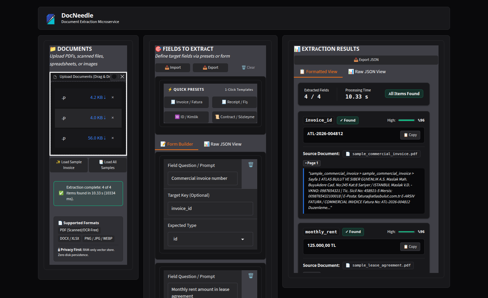

# DocNeedle: Gizlilik Odaklı Yerel Belge Çıkarım Mikroservisi ve Görsel RAG

**DocNeedle**, kullanıcı tanımlı JSON şemalarına dayalı yapılandırılmış verileri, doğrulanabilir kaynak alıntıları ve istatistiksel güven puanlarıyla birlikte yerel yapay zeka modelleri üzerinden çıkaran, gizlilik odaklı bir belge işleme mikroservisi ve etkileşimli web platformudur.

Harici bulut API'lerine veya hata payı yüksek geleneksel optik karakter tanıma (OCR) motorlarına bağımlı sistemlerin aksine DocNeedle; sıfır harici ağ telemetrisi, kesin disk sızıntısız uçucu bellek (RAM) garantisi ve OCR gerektirmeyen görsel RAG mimarisiyle %100 yerel ortamda çalışır.



---

## Mimari ve Temel Yenilikler

```
DocNeedle/
├── assets/                       # Marka grafikleri ve SVG ikonlar
├── app.py                        # Birleşik Gradio 6 arayüzü + FastAPI kök bağlama ve ZeroGPU girişi
├── config.toml                   # Temel uygulama, model ve işlem hattı yapılandırması
├── src/docneedle/
│   ├── main.py                   # FastAPI servis fabrikası, CORS ve /healthz tanı uçları
│   ├── hardening.py              # Linux çekirdeği PR_SET_DUMPABLE bellek dökümü koruması
│   ├── cuda_compat.py            # ZeroGPU önyükleyicileri ve dinamik CUDA sembol yönetimi
│   ├── api/                      # Senkron (/v1/extract) ve asenkron iş uç noktaları
│   ├── jobs/                     # Bellek-içi asenkron iş kuyruğu ve anlık SSE akışı
│   ├── ingest/                   # Docling parçalama, pypdfium2 AcroForm çıkarımı ve görsel rasterizer
│   ├── retrieval/                # Yerel C++ gömme motoru, SessionVectorStore, BM25 ve Qwen3-Reranker
│   ├── extraction/               # Uzamsal çakışma çözümü, şema doğrulama ve güven puanlama
│   └── llm/                      # Qwen3.5-4B GGUF çok modlu çıkarım ve spekülatif kod çözme
└── tests/                        # Sıfır-disk doğrulamalı 159 hermetik birim testi
```

### 1. Sıfır-Disk Bellek-İçi Gizlilik ve Çekirdek Seviyesinde Güvenlik
DocNeedle, kurumsal ve yasal belgeler için üst düzey veri güvenliği ve gizlilik taahhüt eder:
* **Sıfır Disk Kalıcılığı:** Yüklenen belgeler, ayrıştırılan metin parçaları, çapraz modlu vektör gömmeleri ve arama indeksleri yalnızca `SessionVectorStore` içerisindeki uçucu RAM alanında yaşar. Her istek tamamlandığında `finally: store.clear()` bloğu ile tüm bellek tamponları koşulsuz olarak temizlenir.
* **Çekirdek Düzeyinde Bellek Dökümü Koruması:** Linux çekirdeğinin prctl arayüzü kullanılarak (`prctl(PR_SET_DUMPABLE, 0)` - `src/docneedle/hardening.py`), sürecin izinsiz bellek dökümü (core dump) vermesi veya ptrace ile dışarıdan okunması engellenir.
* **Sertleştirilmiş Konteyner Profili:** Salt-okunur kök dosya sistemi (`read_only: true`), tmpfs tabanlı RAM geçici dizini (1 GB, `nosuid`), sıfırlanmış core dump limiti (`ulimits: core: 0`) ve tamamen çevrimdışı Hugging Face kipi (`HF_HUB_OFFLINE=1`) ile çalışır.

```
[Yüklenen Belge ve Şema]
            │
            ▼
┌────────────────────────────────────────────────────────┐
│ Uçucu Bellek-İçi İşlem Hattı (PR_SET_DUMPABLE = 0)     │
│                                                        │
│  Docling Ayrıştırıcı (io.BytesIO) ──► AcroForm Analizi │
│         │                                              │
│         ▼                                              │
│  SessionVectorStore (Bellek-İçi RRF Hibrit İndeks)     │
│         │                                              │
│         ▼                                              │
│  Yerel Çok Modlu LLM (Qwen3.5-4B + mmproj)             │
│         │                                              │
│         ▼                                              │
│  Uzamsal Çakışma Çözücü ve Güven Doğrulayıcı          │
└────────────────────────────────────────────────────────┘
            │
            ▼
[Alıntılı ve Doğrulanmış Yapılandırılmış JSON Çıktısı]
            │
            ▼
  finally: store.clear() (RAM tamamen boşaltılır)
```

### 2. OCR Gerektirmeyen Görsel RAG ve Hibrit Belge Ayrıştırma
Geleneksel belge işleme hatlarında OCR motorlarının el yazısını, kaşeleri, düşük kontrastlı metinleri veya karmaşık tablo hiyerarşilerini yanlış okuması zincirleme hatalara yol açar. DocNeedle, bu kırılganlığı ortadan kaldırmak için uyarlanabilir çift yönlü bir strateji uygular:
* **Dijital Metin Ayrıştırma:** Aranabilir metin katmanı içeren belgeler (`pdf_embedded_text_min_chars = 50`), Docling Core aracılığıyla başlıkları ve tabloları koruyacak şekilde hiyerarşik Markdown parçalarına bölünür.
* **Taranmış Sayfalar ve Görsel Parçalama:** Saf taranmış sayfalar ve görsel formatları (PNG, JPG, TIFF, WEBP), yüksek çözünürlükte (108 DPI) pypdfium2 ile rasterize edilerek metin kaybına uğramadan doğrudan görsel parça olarak sisteme alınır.
* **Çapraz Modlu Doğrulama:** Sayfa görselleri SigLIP projeksiyonu (`mmproj-F16.gguf`) ile vektör uzayına yansıtılır ve çok modlu LLM'e (Qwen3.5-4B) base64 görsel bağlamı olarak aktarılır. Bu sayede faturalar, makbuzlar ve el yazılı formlar kayıpsız işlenir.

### 3. Yerel C++ Çapraz Modlu Gömme Motoru
Gecikmesiz ve yüksek verimli arama sağlamak amacıyla DocNeedle, C++ ile yazılmış bağımsız bir gömme motorunu (`src/docneedle/retrieval/docneedle_embed.cpp`) paylaşımlı kütüphane (`libdocneedle_embed.so`) olarak derler:
* **Birleşik Vektör Uzayı:** Metin sorgularını (`task: search result | query: {text}`) ve ham sayfa görsellerini EmbeddingGemma-2 ile 768 boyutlu L2-normalleştirilmiş tek bir vektör uzayında buluşturur.
* **Önceden Derlenmiş Çok Mimarili CUDA Çekirdekleri:** `libggml-cuda.so`, modern GPU mimarilerini (`sm_80` Ampere, `sm_86`, `sm_89` Ada Lovelace ve `sm_120a` Blackwell) dahili olarak barındırır; anlık JIT derleme gecikmesi olmadan GPU üzerinde anında çalışır.
* **Sembol İzolasyonu:** Python `ctypes` üzerinden `RTLD_LOCAL | RTLD_DEEPBIND` bayraklarıyla yalıtılmış bir alt süreçte yüklenir. Böylece `llama-cpp-python` kütüphanesi ile dahili C++ sembollerinin çakışması kesin olarak engellenir.

### 4. Etkileşimli PDF AcroForm Doğrudan Çıkarımı
Form alanlarında LLM'lerin en sık yaptığı hata, boş onay kutularını dolu varsayması veya etkileşimli alan değerlerini metin katmanından ayıramamasıdır.
* DocNeedle, yerel `pypdfium2` arayüzü (`FPDFPage_GetAnnot`, `FPDFAnnot_GetFormFieldType`) ile PDF nesne akışlarını doğrudan tarar.
* Form alan adlarını, ipuçlarını, onay kutusu durumlarını ve girilmiş değerleri UTF-16LE form akışlarından okur.
* Çıkarılan alanları Markdown tablosu biçiminde yapılandırarak arama öncesi parçaların bağlamına ekler; resmi form ve sözleşmelerde sıfır yanılsama (hallucination) sağlar.

### 5. Uzamsal Çakışma Çözümü (Spatial Collision Resolution)
Bir belgede fatura tutarı veya tarih gibi tek bir belirgin veri bulunduğunda, dil modelleri genellikle o tek veriyi şemada yer alan diğer boş veya eksik alanlara da kopyalama eğilimindedir.
* `SpatialCollisionResolver` (`src/docneedle/extraction/collision.py`), çıkarım sonuçlarını denetleyerek farklı şema anahtarları arasında yinelenen değerleri saptar.
* Değerin kaynak sayfada kaç kez geçtiğini fiziksel olarak doğrular.
* Eğer değer sayfada yalnızca bir kez geçiyorsa, her alanın şema açıklaması ile değerin etrafındaki metin bağlamı arasındaki anlamsal yakınlığı hesaplar.
* Değeri en yüksek bağlamsal ilgiye sahip tek alana atar; diğer çakışan alanları ise güvenli bir şekilde `found: False, value: None` durumuna getirir.

### 6. Hibrit RRF Arama ve Nöral Yeniden Sıralama
* **Reciprocal Rank Fusion (RRF):** EmbeddingGemma-2 yoğun anlamsal gömmeleri ile Okapi BM25 seyrek anahtar kelime sinyalleri, belge çeşitliliği kısıtlarıyla ($k=60$) RRF algoritması üzerinden birleştirilir.
* **Nöral Yeniden Sıralama:** Yüksek doğruluk gerektiren durumlarda aday parçalar **Qwen3-Reranker-0.6B** cross-encoder modeline aktarılarak logit puan farkı (`logit("yes") - logit("no")`) üzerinden elenir.

### 7. Spekülatif Kod Çözme ve KV Bellek Optimizasyonu
* **KV Önbellek Hızlandırması:** Flash Attention ve FP16 / kuantize edilmiş KV önbellek (`model_kv_cache_type_k=1`, `model_kv_cache_type_v=8` [Q8_0]) sayesinde 32.768 token bağlam penceresi tüketici seviyesi VRAM sınırlarında çalıştırılır.
* **Spekülatif Kod Çözme:** Yapılandırılmış JSON üretim hızını katlamak için dahili `LlamaPromptLookupDecoding` (`max_ngram_size=2`, `num_pred_tokens=5`) desteği sunar.

### 8. Birleşik Gradio 6 Arayüzü ve Asenkron Akış API'si
* **7860 Portunda Birleşik Hizmet:** Gradio 6 web arayüzü ve FastAPI REST API uçları tek bir port üzerinden eşzamanlı hizmet verir.
* **Görsel ve Ham Şema Eşitleme:** Form alanlarını açılır menülerle görsel olarak oluşturabilir veya iç içe `$ref` işaretçilerini 20 seviyeye kadar çözebilen çift yönlü senkronize ham JSON şema sekmesini kullanabilirsiniz.
* **Asenkron İşler ve Canlı SSE:** Çok belgeli toplu işler (`POST /v1/jobs`), Server-Sent Events (`GET /v1/jobs/{id}/events`) üzerinden anlık ilerleme yüzdesi ve alan bazında çıkarım olayları akıtır.

---

## ExtractBench Kıyaslama ve Liderlik Tablosu

DocNeedle, faturalar, resmi yazışmalar, finansal raporlar ve el yazılı notlardan oluşan **370 belge**, **4.869 sayfa** ve **13.577 etiketli alan** içeren kurumsal **ExtractBench** (LlamaIndex, arXiv:2607.29677) veri setinde test edilmiştir.

| Sistem / Model | Mimari ve Dağıtım | Genel Değer F1 | Kısa (≤10s) | Orta (11-50s) | Uzun (>50s) | Sayfa Konumu | Sayfa Başı Maliyet | Gizlilik ve Depolama |
| :--- | :--- | :---: | :---: | :---: | :---: | :---: | :---: | :--- |
| **LlamaExtract Agentic Plus** | Bulut Ajan İş Hattı | **96.17%** | 97.02% | 94.30% | 94.65% | 88.26% | $0.0750 | Bulut API (Harici) |
| **Codex (GPT-6.1 Sol Evidence)** | Frontier Kodlama Ajanı | **95.31%** | 97.01% | 92.96% | 85.46% | 89.37% | $0.0713 | Bulut API (Harici) |
| **Claude Code (Sonnet 5.5 Evidence)**| Frontier Kodlama Ajanı | **94.68%** | 96.22% | 92.97% | 83.69% | 75.99% | $0.0569 | Bulut API (Harici) |
| **OpenAI GPT-6 Astra** | Ticari Büyük VLM | **91.91%** | 97.22% | 90.56% | 31.70% | 0.00% *(Yok)* | $0.1109 | Bulut API (Harici) |
| **Qwen3.5 4B (Yalın Temel Model)** | Bağımsız Temel Model | **82.43%** | 89.06% | 76.64% | 27.31% | 0.00% *(Yok)* | Ücretsiz (yerel) | Yerel / Self-Hosted |
| **Google Gemini 3.8 Flash** | Ticari Hızlı VLM | **80.71%** | 88.14% | 72.23% | 28.70% | 0.00% *(Yok)* | $0.0043 | Bulut API (Harici) |
| **DocNeedle (Süreç İçi)** | **Qwen3.5-4B + Gemma2-RAG** | **75.71%** | **77.16%** | **69.70%** | **71.43%** | **80.95%** | **$0.00 (yerel)** | **Sıfır-Disk RAM / Hava Boşluklu** |

### Öne Çıkan Kıyaslama Bulguları
* **Uzun Belgelerde Yüksek Dayanıklılık (Temel Modele Karşı +44.12 Puan):** 50 sayfayı aşan hacimli dokümanlarda RAG desteği olmayan büyük modeller dikkat dağınıklığı yaşayarak çökerken (yalın Qwen3.5 4B %27.31'e, GPT-6 Astra %31.70'e düşer), DocNeedle görsel ve metinsel parçaları hedefe odaklı filtreleyerek **%71.43 F1** başarısını korur.
* **Denetlenebilir Sayfa Konumlandırması (%90.67 Kısa, %80.95 Genel):** Ticari VLM'ler kaynak atfında %0.00 alırken, DocNeedle her çıkarılan alan için doğrulanmış sayfa numarası ve doğrudan alıntı metni sunar.
* **%100 Yerel ve Sıfır Maliyetli Çalışma:** Sayfa başına $0.00 maliyetle çalışırken, uçucu RAM garantileriyle kurumsal veri sızıntılarını tamamen engeller.

---

## Kullanılan Teknolojiler

* **Çekirdek Çalışma Zamanı ve Servis:** Python 3.14+, FastAPI 0.115+, Pydantic v2, Uvicorn, Server-Sent Events (SSE)
* **Kullanıcı Arayüzü:** Gradio 6+ (Dinamik Şema Oluşturucu, Koyu Tema, Anlık İlerleme Göstergeleri)
* **Süreç-İçi Model Çıkarımı:** `llama-cpp-python` (CUDA/cuBLAS & Flash Attention hızlandırmalı), Qwen3.5-4B GGUF Çok Modlu Model, SigLIP Görsel Projektör
* **Çapraz Modlu Vektör Gömme ve Yerel Çekirdek:** C++ (`docneedle_embed.cpp`, `libdocneedle_embed.so`), EmbeddingGemma-2 GGUF, `ctypes` süreç izolasyonu
* **Belge Ayrıştırma ve İşleme:** Docling Core 2.15+, `pypdfium2` (AcroForm ayrıştırıcı ve 108 DPI rasterizer), `python-docx`, `openpyxl`, Pillow
* **Arama ve Sıralama:** Okapi BM25 (`rank-bm25`), Reciprocal Rank Fusion (RRF), Qwen3-Reranker-0.6B GGUF
* **Güvenlik ve Konteyner:** Linux `prctl(PR_SET_DUMPABLE, 0)`, Docker, Docker Compose, Hugging Face Spaces (ZeroGPU)
* **Test ve Doğrulama:** Pytest (159 otomatik birim testi), Ruff, Sıfır-Disk CI doğrulaması
